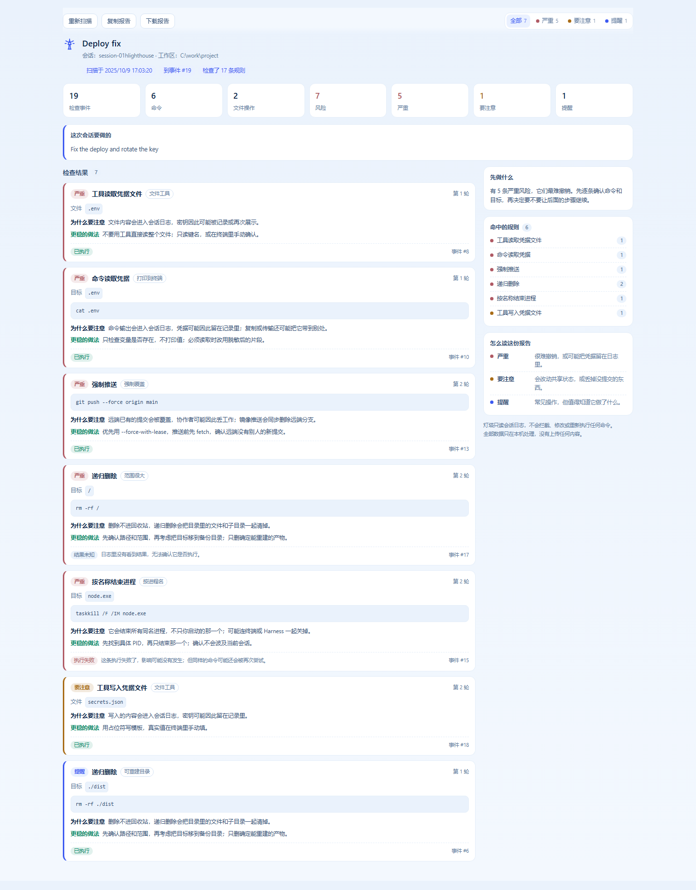

# 灯塔 · dsh-lighthouse

中文 | [English](README.md)

一个装进 DeepSeek Harness 的标签页：**读当前这次会话，把那些做了就很难撤回的操作挑出来。**

Agent 干活很快。等你回头，可能已经有目录被删、分支被强推、密钥文件被读过、某个名字的进程被全部杀掉。日志其实都记着，只是没人会一行行翻。灯塔就是替你把这份日志再读一遍：每条风险都写清楚动了什么、可能影响什么、下次怎么做更稳。

它只读。不拦工具、不改命令、也不会把任何东西重跑一遍。



*示例会话，不是真实运行：演示数据里的七条风险各展示一次。*

## 装上之后看到什么

打开一个对话，点顶部的 **灯塔** 标签。

### 七个数字

检查了多少条事件、执行过多少条命令、做过多少次文件读写、发现多少处风险，以及其中严重、要注意、提醒各有多少。全部从日志里数出来，没有估算。

标题旁边的标签还会说明：这次检查了多少条规则、扫描到第几条事件、有没有内容被脱敏。

### 每条风险卡片

四件事，用大白话写清楚：

- **发生了什么** —— 规则名称、一个短标签（比如「大范围」「强制」），以及发生在第几轮。
- **动了什么** —— 目标路径、文件、进程名、数据表或网站；下面附上日志里的原命令或文件操作。
- **为什么要留意** —— 这一步为什么难撤销。
- **更稳的做法** —— 具体能怎么改。

卡片底部会说清这条动作是 **已执行**、**执行失败**，还是 **结果未知**。失败的尝试可能什么都没做，但同样的命令还可能被再试一次；没看到结果的，灯塔不会当成成功。后面的「事件 #」可以直接对回会话日志里的那一行。

相同的动作会合并成一条，显示出现次数和首尾轮次，不会把一条命令复制七遍。

### 筛选和带走

- 按 **严重 / 要注意 / 提醒** 筛选。
- **复制报告** 把一份 Markdown 放到剪贴板。
- **下载报告** 保存为 `lighthouse-<会话>.md`。
- **重新扫描** 再读一遍当前会话，适合 agent 又干了一会儿之后用。

报告和页面用同一套说法。如果条目超过了上限，报告会明确写出来。

## 它会检查什么

一共 17 条规则，分七组。

### 删除

`rm -rf`、`del /s`、`rd /s`、`Remove-Item -Recurse`、`ri`。递归删除的目标如果是 `/`、主目录、整个盘、`C:\Windows`、当前工作区本身或 `.git`，算 **严重**；如果目标全是 `node_modules`、`dist`、`.cache` 这类能重新生成的目录，只算 **提醒**；其他情况算 **要注意**。不带递归的普通删除不报。

### Git

- `git clean -f` —— 要注意；连忽略文件一起清（`-x`）算严重。`git clean -n` 只是预览，不报。
- `git reset --hard` —— 严重。
- `git checkout -- .`、`git checkout .`、`git checkout -f`、`git restore` —— 要注意。只带 `--staged` 的 `git restore` 不报，因为它只是把改动移出暂存区。
- 强推 —— `--force`、`+refspec`、镜像推送算严重；`--delete` 算要注意；`--force-with-lease` 只算提醒，因为它会先确认远端有没有新提交，但仍然会覆盖远端分支。

### 进程

`taskkill /IM`、`Stop-Process -Name`、`killall`，以及不带 `-x` 的 `pkill`。按名字结束会波及所有同名进程，不只是你启动的那一个。目标看起来像编辑器、终端、Node 或 Harness 本身时算 **严重**，其他名字算 **要注意**。按 PID 只杀一个进程的不报。

### 凭据

- 用命令打印凭据文件（`cat`、`grep`、`Get-Content` 等）—— 严重。
- 在本地复制凭据文件（`cp`、`copy`）—— 要注意，因为密钥多了一份。
- 传到别的机器（`scp`）—— 严重。
- 文件工具 `read` 读凭据文件 —— 严重。
- 文件工具 `write` / `edit` 写凭据文件 —— 要注意。

模板和公钥不管：`.env.example`、`*.sample`、`*.template`、`id_rsa.pub`。叫 `credentials.ts` 的是源码，不会当成密钥文件。

### 数据库

`DROP TABLE / DATABASE / SCHEMA`、`TRUNCATE`、没有 `WHERE` 的 `DELETE FROM`、`db.dropDatabase()`，并且命令必须真的以常见 SQL 客户端开头。全是严重。所以 `echo "DROP TABLE users"` 只是说了一句话，不会被当成删表。

### 系统与包管理器

`sudo` / `runas` —— 提醒。`chmod 777`、`icacls … /grant Everyone` —— 要注意。改全局 git 或包管理器配置、`setx`、持久化环境变量 —— 要注意。全局安装包 —— 提醒。`docker … prune` —— 要注意。`format C:`、`mkfs`、`diskpart clean` —— 严重。

### 网络

`curl | sh` 这一类（还包括 `wget`、`iwr`、`irm` 直接管道进 shell 或解释器）—— 严重，并显示下载来源的域名。只有命令真的以下载程序开头才会报，所以写在 `echo` 里的字符串不会触发。

## 它怎么避免误报

一个什么都报的扫描器，比没有还烦。所以检测故意收得很紧：

- 只在引号外面按 `;`、`&&`、`||` 和换行拆命令。路径或提示里带分号，不会被拆成两条。
- 系统、数据库、管道规则必须由真正的程序开头；聊天或字符串里提到 `DROP TABLE`、`curl | sh` 不算。
- `/home`、`/srv` 这种 Unix 绝对路径会被当成路径，不会当成 Windows 开关。
- PowerShell 的长开关不会被拆成一堆单字母：`-Force` 里没有 `-Recurse`。
- 示例文件、模板、公钥、`git clean -n`、`git restore --staged`、`pkill -x`、只杀一个 PID，都刻意放过。
- 失败的命令照样列出来，但会标成失败，不假装它已经生效。
- 成功、失败、结果未知的相同动作会分开记，因为它们的含义不一样。

## 隐私

所有处理都在本机完成。

- 只通过 Harness 自己的 `sessionQuery` 读当前这一次会话。
- 敏感内容在到达页面前就被遮掉：私钥块、JWT、GitHub / AWS / Google / Slack / npm / PyPI / Stripe / DeepSeek 形态的密钥、`Bearer` 头、URL 里的账号密码、`api_key = …` 这类赋值，以及邮箱地址，都会变成 `«已脱敏»`。
- 页面只报告遮了多少处、涉及哪几类，不会显示密钥本身。
- 标题、目标、每条命令、每个路径、每个目标和工作区路径，都走同一套脱敏。
- 脱敏默认开启。关掉后，页面会明确写出来，不会假装跑过。
- 不上传任何内容。插件不发模型请求、不调用 shell、不做遥测。

## 安装

需要 Node.js 22.19+（或 24+）和 DeepSeek Harness 0.1.0-rc.6+。

```sh
git clone https://github.com/xh0915/dsh-lighthouse
cd dsh-lighthouse
pnpm install
pnpm run build
dsh plugin --profile web add .
```

重启 Web Harness，打开一个对话，**灯塔** 标签就在顶部。

**一定要先跑 `pnpm run build`，再 `add`。** 这个包没有安装时构建脚本（pnpm 10 会拦下未批准的 `prepare`）；跳过构建，插件能装上但加载不了。

卸载：

```sh
dsh plugin --profile web remove dsh-lighthouse
```

## 设置

```yaml
dsh-lighthouse:
  redactSecrets: true   # 到页面之前先脱敏（默认）
  maxFindings: 50       # 最多保留多少条，5–200
```

一次会话的风险条目超过上限时，保留前面的，页面和报告都会写明列表被截断。不会悄悄少几条。

## 边界

- **只认日志里真实发生过的。** 一条风险必须对应一次工具调用；灯塔不会因为模型说了一句危险的话就报。
- **只读。** 它不能拦工具、不能改命令、不能替你批准什么。它只是对已经发生的操作做第二遍检查。
- **一次只看一个会话。** 扫的是你当前打开的对话，不是全部历史。
- **命令和文件工具。** 自定义工具只有参数里带 `command`（shell 工具）或 `file_path`（read / write / edit 工具）时才会被看到。
- **不自动修复。** 「更稳的做法」是建议，不是一按就执行的按钮。
- **不给费用数字。** 日志里没有价格，插件不猜。
- 界面跟随 Harness 的明暗主题，支持中文和英文。

## 技术细节

<details>
<summary>给要改代码的人</summary>

### 目录

```text
package.json           # dsh.bundle.patch + dsh.client、脚本、peer 依赖
cordis.patch.yml       # 把宿主插件行挂进 profile
dsh.plugin.json        # 注册清单
src/index.ts           # 宿主入口：Config、runtime、Typert 清单
src/runtime.ts         # lighthouse.scan(sessionId)
src/detect.ts          # 会话日志 -> 风险（规则、合并、结果、脱敏）
src/rules.ts           # 封闭的规则 id 列表，浏览器也引用
src/schema.ts          # Zod 线上契约（类型由它推出）
src/contract.ts        # 宿主和客户端共用的严格 InvocationDescriptor
src/typert.ts          # 宿主反射清单
src/redact.ts          # 本地脱敏
src/client/index.tsx   # 客户端入口：挂 Remote、注册标签
src/client/view.tsx    # 灯塔界面
src/client/catalog.ts  # 规则 / 变体 / 级别 id -> 文案 key
src/client/report.ts   # Markdown 报告
src/client/styles.ts   # 跟随 Harness 明暗主题的样式
src/client/locales.ts  # 中英文案
tests/                 # 检测、报告、文案表、契约、客户端入口测试
build.mjs              # esbuild 双构建：宿主 ESM + Web loader 的客户端
```

宿主只发 id 和证据，不发文案；所有文字都在浏览器这边。`catalog.ts` 在编译时把每个 id 映射到文案 key，少一条翻译会直接构建失败，而不是在页面上显示 `rule.git-reset-hard.safe`。

### 开发

```sh
pnpm run check   # 类型检查 + lint + 测试 + 构建
```

最需要测的是检测器。测试夹具按 Harness 真实发出的事件形状（`tool/call`、`tool/result`、`turn/start`、`user/message`、`session/title`）搭日志；除了「报了什么」，也测「刻意不报什么」。

### 改名

如果你 fork 后要改名，这些地方要一起改：`package.json` → `name`、`exports`、`files`；`build.mjs` → `__ModuleLoader__.load` 的 id；`src/index.ts` → `name`；`src/client/remote.ts` → 十六进制编码的 `TypertRemoteNamespace$…`；`src/client/locales.ts` → locale 命名空间；`src/client/index.tsx` → slot id；`src/typert.ts` → `package`；`src/contract.ts` → invocation id；`cordis.patch.yml` → `id` 和 `name`；`dsh.plugin.json` → `id`。

</details>

## License

MIT

由 [里卡多 / xh0915](https://xh0915.github.io) 制作
